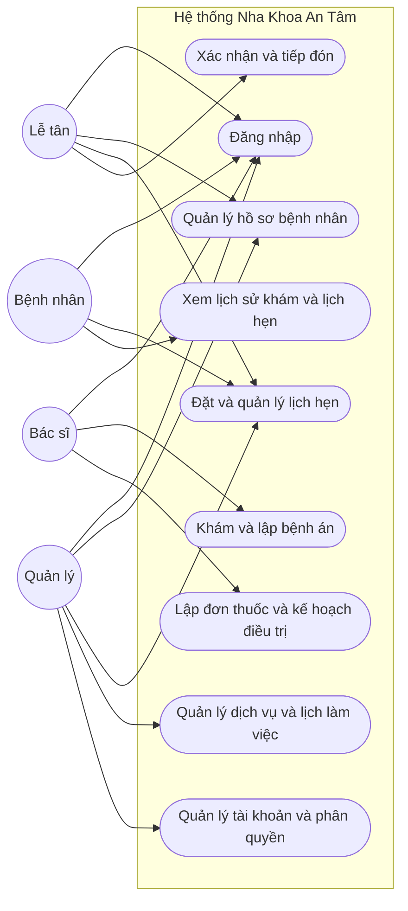
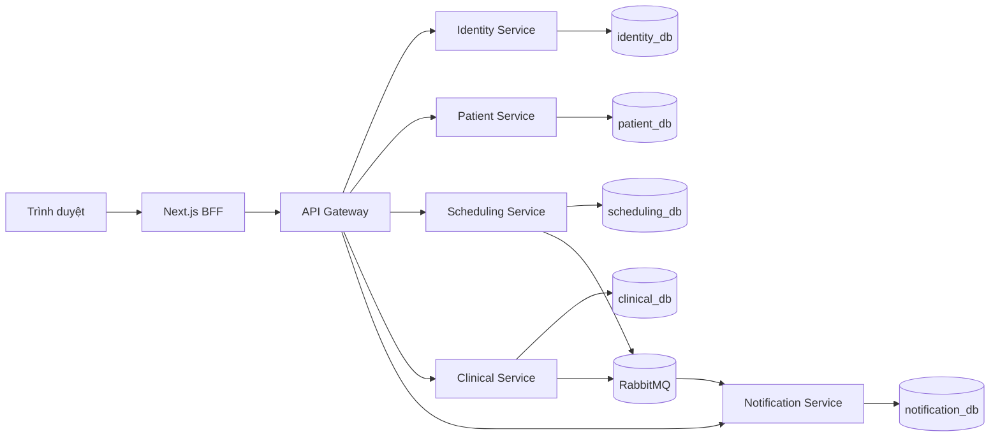

# Nha Khoa An Tâm

Ứng dụng web hỗ trợ vận hành phòng khám nha khoa, từ quản lý hồ sơ bệnh nhân và lịch hẹn đến khám, bệnh án và kế hoạch điều trị. Dự án được tổ chức theo các service nghiệp vụ, dùng PostgreSQL, giao diện tiếng Việt và dữ liệu demo.

> Tài liệu README trước đây được lưu tại [docs/README.md](docs/README.md). Hướng dẫn cài đặt và chạy chi tiết: [docs/huong-dan-chay.md](docs/huong-dan-chay.md).

## Mục tiêu và chức năng

- Quản lý tài khoản và quyền theo vai trò: lễ tân, bác sĩ, bệnh nhân, quản lý.
- Tạo và quản lý hồ sơ hành chính bệnh nhân; tìm kiếm và liên kết hồ sơ với tài khoản.
- Đặt, xác nhận, tiếp đón, đổi và hủy lịch; kiểm tra lịch bác sĩ, ghế, ngày nghỉ và lịch đóng cửa.
- Quản lý dịch vụ, ghế, ca làm, ngày nghỉ và lịch làm việc của phòng khám.
- Tạo bệnh án từ lịch khám, lưu bản nháp, ghi nhận răng và thủ thuật, chốt bệnh án, lập đơn thuốc và kế hoạch điều trị.
- Cho phép bệnh nhân xem lịch hẹn, bệnh án đã chốt và kế hoạch điều trị được duyệt.
- Lưu trữ tệp lâm sàng trong MinIO private; xử lý thông báo và email demo qua RabbitMQ/Mailpit.

## Use Case tổng quát



## Đặc tả Use Case chính

### UC-01 — Đặt lịch hẹn

- **Tác nhân chính:** Lễ tân hoặc bệnh nhân đã đăng nhập.
- **Kích hoạt:** Người dùng gửi yêu cầu đặt lịch trên giao diện.
- **Điều kiện trước:** Tài khoản còn hiệu lực; có hồ sơ bệnh nhân, dịch vụ và khung giờ khả dụng.
- **Luồng chính:** 1) Chọn hồ sơ bệnh nhân và dịch vụ. 2) Chọn bác sĩ, ghế và thời gian. 3) Hệ thống kiểm tra quyền truy cập hồ sơ, lịch làm, ngày nghỉ, lịch đóng cửa và xung đột tài nguyên. 4) Hệ thống lưu lịch hẹn cùng thông tin dịch vụ tại thời điểm đặt, audit và outbox trong transaction. 5) Giao diện nhận kết quả; thông báo được xử lý bất đồng bộ.
- **Ngoại lệ:** Dữ liệu không hợp lệ thì trả lỗi validation; tài khoản không có quyền thì từ chối; khung giờ vừa bị đặt hoặc không còn hợp lệ thì trả xung đột và không tạo lịch hẹn.
- **Điều kiện sau:** Thành công thì lịch được tạo với trạng thái `BOOKED`; nếu yêu cầu thất bại thì không tạo lịch mới.

### UC-02 — Tiếp đón và bắt đầu lượt khám

- **Tác nhân chính:** Lễ tân tiếp đón; bác sĩ bắt đầu khám.
- **Kích hoạt:** Bệnh nhân đến phòng khám và lễ tân thực hiện tiếp đón.
- **Điều kiện trước:** Lịch hẹn đã được xác nhận.
- **Luồng chính:** 1) Lễ tân mở lịch hẹn và thực hiện tiếp đón, trạng thái chuyển từ `CONFIRMED` sang `ARRIVED`. 2) Bác sĩ phụ trách mở lượt khám và bắt đầu, trạng thái chuyển sang `IN_PROGRESS`. 3) Hệ thống ghi nhận người thao tác và kiểm tra quy tắc chuyển trạng thái.
- **Ngoại lệ:** Vai trò không phù hợp, lịch hẹn chưa xác nhận hoặc trạng thái hiện tại không cho phép thao tác thì hệ thống từ chối chuyển trạng thái.
- **Điều kiện sau:** Lịch hẹn lưu trạng thái mới hợp lệ; nếu yêu cầu chuyển trạng thái bị từ chối thì trạng thái của thao tác đó không đổi.

### UC-03 — Lập và chốt bệnh án

- **Tác nhân chính:** Bác sĩ phụ trách lượt khám.
- **Kích hoạt:** Bác sĩ chọn tạo bệnh án cho lịch hẹn được phân công.
- **Điều kiện trước:** Bác sĩ đã đăng nhập và được phân công cho lịch hẹn.
- **Luồng chính:** 1) Tạo bệnh án từ lịch hẹn. 2) Nhập triệu chứng, tiền sử, kết quả khám và chẩn đoán; lưu bản nháp có version. 3) Ghi nhận tình trạng răng/thủ thuật và các nội dung điều trị. 4) Chốt bệnh án với version hiện hành. 5) Hệ thống đánh dấu hồ sơ `SIGNED`, ghi audit và phát sự kiện để cập nhật lịch hẹn hoàn tất.
- **Ngoại lệ:** Bác sĩ không phụ trách bị từ chối; dữ liệu sai quy tắc bị báo lỗi validation; version đã cũ trả lỗi xung đột; bệnh án đã chốt không cho sửa trực tiếp (cần tạo hồ sơ bổ sung nếu được phép).
- **Điều kiện sau:** Bệnh án được lưu và chốt bất biến; sự kiện cập nhật lịch được phát sau khi transaction chốt thành công.

Hai luồng tuần tự quan trọng — đặt lịch và chốt bệnh án — được mô tả tại [docs/api/sequences.md](docs/api/sequences.md) và [docs/architecture/overview.md](docs/architecture/overview.md). Mô hình dữ liệu nằm ở [docs/database/erd.md](docs/database/erd.md); quy tắc trạng thái lịch hẹn được mô tả trong tài liệu kiến trúc.

## Kiến trúc và công nghệ

| Thành phần | Công nghệ / trách nhiệm |
|---|---|
| Giao diện và BFF | Next.js 16, React 19, TypeScript; form dùng React Hook Form và Zod |
| API | Java 21, Spring Boot 4, Spring Cloud Gateway, REST/OpenAPI |
| Truy cập dữ liệu | PostgreSQL qua JDBC `JdbcTemplate`; Flyway quản lý migration riêng theo service |
| Phiên đăng nhập | Redis lưu session phía server; cookie trình duyệt `HttpOnly` |
| Tác vụ bất đồng bộ | RabbitMQ, transactional outbox/inbox, worker gửi email |
| Lưu trữ tệp | MinIO theo giao thức S3, bucket private |
| Chạy local | Docker Compose; Mailpit nhận email demo |



Mỗi service sở hữu dữ liệu riêng; giao tiếp giữa service dùng API/sự kiện thay vì khóa ngoại liên database. Chi tiết tại [docs/architecture/overview.md](docs/architecture/overview.md) và [docs/database/ownership.md](docs/database/ownership.md).

## Cấu trúc mã nguồn

- `frontend/web`: giao diện và Backend-for-Frontend.
- `backend/api-gateway`: xác thực token, giới hạn tốc độ và định tuyến API.
- `backend/identity-service`: tài khoản, đăng nhập, session token và phân quyền.
- `backend/patient-service`: hồ sơ bệnh nhân và liên kết tài khoản.
- `backend/scheduling-service`: lịch hẹn, dịch vụ và lịch làm việc.
- `backend/clinical-service`: bệnh án, thủ thuật, đơn thuốc, kế hoạch điều trị và tệp.
- `backend/notification-service`: thông báo và email.
- `backend/common-lib`: thành phần dùng chung.
- `contracts/openapi`: hợp đồng API.
- `infrastructure/compose`: cấu hình Docker Compose.
- `docs`: tài liệu kiến trúc, API, dữ liệu, kiểm thử và vận hành.

## Tài liệu thiết kế

- Sơ đồ Use Case tổng quát và ba Use Case chính được trình bày ở trên.
- Sequence diagram cho luồng đặt lịch và chốt bệnh án: [docs/api/sequences.md](docs/api/sequences.md).
- Tổng quan kiến trúc và luồng giữa các service: [docs/architecture/overview.md](docs/architecture/overview.md).
- ERD và quyền sở hữu dữ liệu: [docs/database/erd.md](docs/database/erd.md), [docs/database/ownership.md](docs/database/ownership.md).
- Quy tắc nghiệp vụ: [docs/business-rules-summary.md](docs/business-rules-summary.md).
- API contract: `contracts/openapi/clinic-api.yaml`.
- Kế hoạch và các trường hợp kiểm thử: [docs/testing/backend-test-plan.md](docs/testing/backend-test-plan.md).

## Chạy ứng dụng local

Yêu cầu: Windows, Docker Desktop ở chế độ Linux containers, Docker Compose v2. Mở PowerShell tại thư mục dự án:

```powershell
.\scripts\bootstrap.ps1
docker --context default compose --env-file .env -f infrastructure/compose/docker-compose.yml up --build --wait --wait-timeout 300 -d
```

Sau khi các container healthy, truy cập:

| Thành phần | Địa chỉ |
|---|---|
| Web phòng khám | <http://localhost:3000> |
| API Gateway | <http://localhost:8081> |
| Mailpit | <http://localhost:8025> |
| RabbitMQ Management | <http://localhost:15673> |
| MinIO Console | <http://localhost:9001> |

Tài khoản demo và hướng dẫn chạy lại, xem log, dừng ứng dụng, xử lý lỗi được ghi tại [docs/huong-dan-chay.md](docs/huong-dan-chay.md). Mật khẩu nằm trong `.env`; không commit hoặc gửi file này. Chỉ sử dụng dữ liệu tổng hợp trong demo.

## Kiểm thử

Các ví dụ kiểm thử hiện có:

- `AppointmentStateMachineTest`: kiểm tra chuyển trạng thái lịch hợp lệ và các trường hợp sai quyền/trạng thái.
- `AppointmentExclusionIntegrationTest`: kiểm tra xung đột khi đặt lịch đồng thời và rollback khi đổi lịch thất bại.
- `ClinicalRecordImmutabilityIntegrationTest`: kiểm tra dữ liệu bệnh án đã chốt không bị sửa trực tiếp.
- `frontend/web/e2e/clinic-flow.spec.ts`: luồng trình duyệt nhiều vai trò.

Chạy backend từ thư mục gốc bằng Maven Wrapper:

```powershell
.\mvnw.cmd -B verify
```

Chạy các lệnh frontend từ thư mục gốc (đã cài Node/pnpm theo `frontend/web/package.json`):

```powershell
pnpm --dir frontend/web lint
pnpm --dir frontend/web typecheck
pnpm --dir frontend/web test:e2e
```

Các integration test dùng PostgreSQL Testcontainers; cần Docker đang chạy để thực thi nhóm kiểm thử này.

## Luồng demo

Đăng nhập bằng tài khoản demo, tạo hoặc tra cứu hồ sơ bệnh nhân, đặt và tiếp đón lịch hẹn, sau đó mở bệnh án để lưu nháp và chốt. Có thể kiểm tra dữ liệu được lưu trong PostgreSQL, chạy các test case tiêu biểu và xem email demo trong Mailpit. Hướng dẫn tài khoản và dịch vụ local nằm tại [docs/huong-dan-chay.md](docs/huong-dan-chay.md).

## Phạm vi phiên bản

Hệ thống tập trung vào quản lý tài khoản, hồ sơ bệnh nhân, lịch hẹn và quy trình khám chữa bệnh tại một phòng khám. Các chức năng thanh toán/hóa đơn, kho vật tư, CRM, labo, SMS/Zalo và vận hành nhiều cơ sở chưa thuộc phạm vi hiện tại. Hệ thống sử dụng dữ liệu tổng hợp; không nhập dữ liệu bệnh nhân thật vào môi trường local. Xem [giới hạn và roadmap](docs/roadmap/limits.md).
