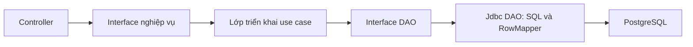

# Tầng DAO, interface nghiệp vụ và CRUD bệnh nhân

## Cấu trúc

Các controller phụ thuộc vào interface nghiệp vụ (`PatientService`, `AppointmentService`,
`AppointmentWriter`, `SchedulingAdminService`, `ClinicalRecordWriter`, `ClinicalFileService`,
`TreatmentPlanService`, `AuthService`, `UserAdminService`). Spring inject lớp `*Impl` tương ứng.

`@Transactional` ở lớp triển khai nghiệp vụ. DAO dùng cùng datasource và transaction Spring,
không tự commit hoặc mở transaction riêng. Audit/outbox tiếp tục ghi cùng transaction với dữ liệu
nghiệp vụ. SQL và mapping ResultSet nằm trong `persistence/Jdbc*Dao.java`; script migration và
seed khởi tạo môi trường vẫn có SQL riêng. Các worker/consumer cũng truy cập dữ liệu qua DAO.

## Use case hồ sơ bệnh nhân

| Thao tác | API | Quy tắc |
|---|---|---|
| Tạo | POST `/api/v1/patients` | Kiểm tra họ tên, điện thoại, giới tính, ngày sinh; tạo mã và audit |
| Đọc/tìm | GET `/api/v1/patients`, GET `/api/v1/patients/{id}` | Lọc ACTIVE/ARCHIVED/ALL; kiểm tra quyền khi xem từng hồ sơ |
| Sửa | PUT `/api/v1/patients/{id}` | Hồ sơ phải hoạt động; chỉ sửa hành chính, giữ dị ứng/tiền sử lâm sàng |
| Xóa | DELETE `/api/v1/patients/{id}` | Chưa có bất kỳ lịch hẹn, liên kết tài khoản, consent hay access grant; giữ audit |
| Lưu trữ | POST `/api/v1/patients/{id}/archive` | Không còn lịch BOOKED/CONFIRMED/ARRIVED/IN_PROGRESS |
| Khôi phục | POST `/api/v1/patients/{id}/restore` | Hồ sơ vẫn tồn tại; cho phép sửa và đặt lịch trở lại |

Lễ tân, quản lý và SUPER_ADMIN được thao tác hành chính. Bệnh nhân không được gọi các API ghi
này. Lưu trữ dùng cột `patients.deleted_at` sẵn có, không xóa bệnh án hay tài khoản liên kết.
Tra cứu lịch sử, `/patients/me` và kiểm tra quyền lâm sàng vẫn đọc được hồ sơ lưu trữ.
Danh sách chọn bệnh nhân để đặt lịch mặc định chỉ lấy ACTIVE.

CRUD không áp dụng máy móc lên mọi bảng: bệnh án đã chốt dùng bổ sung, đơn thuốc đã phát hành
và kế hoạch đã duyệt giữ bất biến; lịch hẹn dùng hủy thay vì xóa lịch sử.

## Đồng thời và lỗi giữa hai service

Database của patient và scheduling độc lập. Migration `V2__patient_lifecycle.sql` bổ sung bảng
guard tại scheduling; tombstone không có FK sang database khác và không bị xóa sau khi xóa bệnh nhân.

1. Patient service khóa row bệnh nhân trong transaction; đăng ký compensation trước khi gọi scheduling.
2. Endpoint nội bộ `/internal/patients/{id}/lifecycle` khóa advisory `1:patient:<id>`, kiểm tra lịch hẹn
   và ghi trạng thái guard. Endpoint này không được API gateway định tuyến và yêu cầu JWT nhân viên.
3. Đặt/đổi lịch giữ cùng khóa và kiểm tra guard ACTIVE trong transaction ghi lịch. Một yêu cầu đã
   đọc được hồ sơ trước lúc xóa/lưu trữ cũng không thể vượt qua guard sau khi trạng thái đổi.
4. Patient service ghi trạng thái/xóa và audit trong transaction local. Nếu rollback, compensation
   khôi phục guard theo `operationId`; compensation cũ không được ghi đè thao tác mới.

Đây là phối hợp có compensation, không phải transaction phân tán nguyên tử. Nếu tiến trình dừng
đột ngột hoặc compensation thất bại, guard giữ trạng thái chặn đặt lịch để tránh tham chiếu sai.
Với hồ sơ local vẫn tồn tại, nhân viên dùng Khôi phục hoặc thử lại thao tác để đồng bộ lại guard.
Log `Patient lifecycle rollback needs retry` có patient ID/operation ID để hỗ trợ xử lý; không ghi token.

## Minh chứng kiểm thử

- `PatientCrudIntegrationTest`: C/R/U/D thực tế bằng PostgreSQL, giữ trường lâm sàng và audit;
  lưu trữ/khôi phục; từ chối xóa hồ sơ liên kết; rollback và compensation.
- `PatientControllerAuthorizationTest`: bệnh nhân không được sửa/xóa/lưu trữ; tài khoản không vai trò bị từ chối đọc.
- `PatientLifecycleIntegrationTest`: chặn booking đã đọc dữ liệu cũ, từ chối archive lịch đang chờ,
  vẫn đọc được lịch sử đã hủy, xử lý booking đồng thời và compensation cũ.
- `e2e/clinic-flow.spec.ts`: luồng khám nhiều vai trò hiện có và CRUD/lưu trữ/khôi phục trên giao diện.

Chạy backend bằng JDK 21 và Docker Desktop: `./mvnw.cmd -B verify`.
Chạy frontend: `pnpm --dir frontend/web lint`, `pnpm --dir frontend/web typecheck`,
`pnpm --dir frontend/web test:e2e` (stack phải chạy trước).

Build và bật bản mới theo `docs/huong-dan-chay.md`; Flyway tự áp dụng migration mới.
