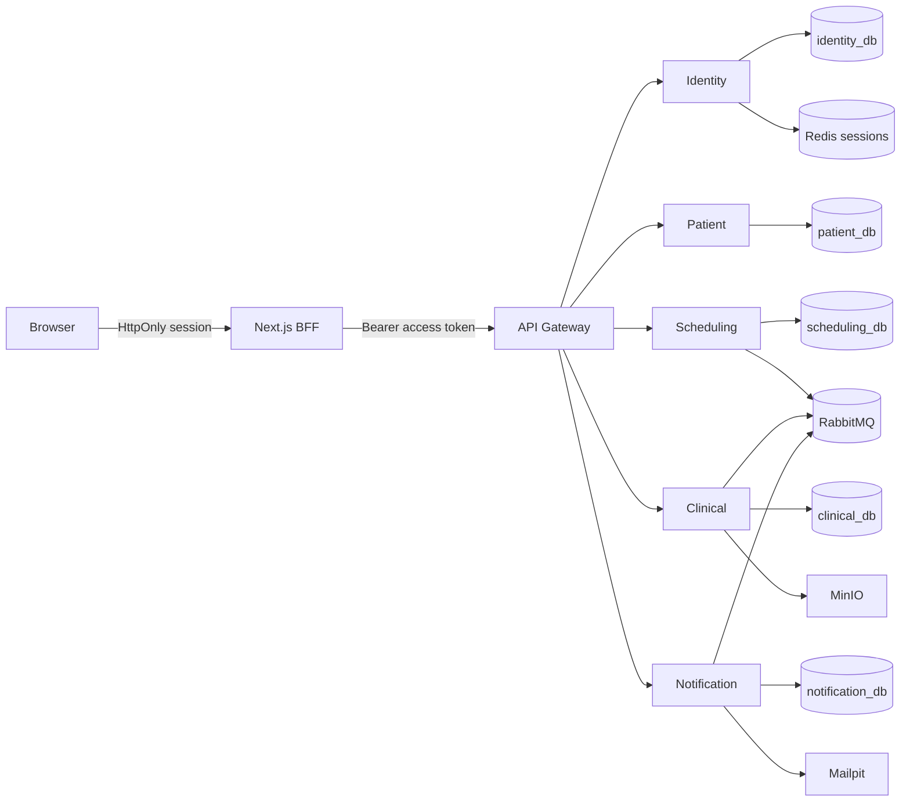
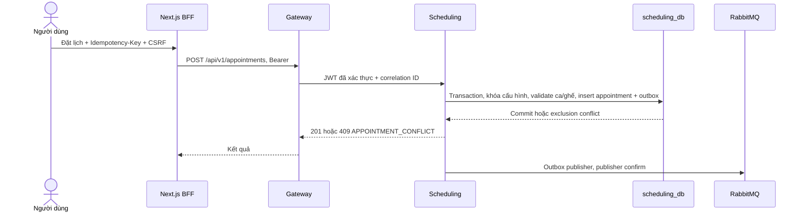

# Tổng quan kiến trúc



Mỗi service sở hữu một database, migration và DB user. ID tham chiếu không tạo FK chéo service. Gateway xác minh chữ ký JWT/JWKS, giới hạn tốc độ và correlation ID; service tự kiểm issuer/audience/expiry/role. BFF giữ access/refresh token server-side trong Redis và phát opaque cookie HttpOnly cho trình duyệt.



```mermaid
sequenceDiagram
  actor Doctor as Bác sĩ
  participant C as Clinical
  participant DB as clinical_db
  participant Q as RabbitMQ
  participant S as Scheduling
  Doctor->>C: Chốt bản nháp
  C->>DB: Transaction + audit + outbox; ký chỉ bác sĩ phụ trách
  DB-->>C: Commit, bản bệnh án bất biến
  C->>Q: ClinicalRecordSigned.v1 (at-least-once)
  Q->>S: Inbox eventId + aggregateVersion
  S->>S: Kiểm appointment/doctor, đánh dấu COMPLETED idempotently
```

