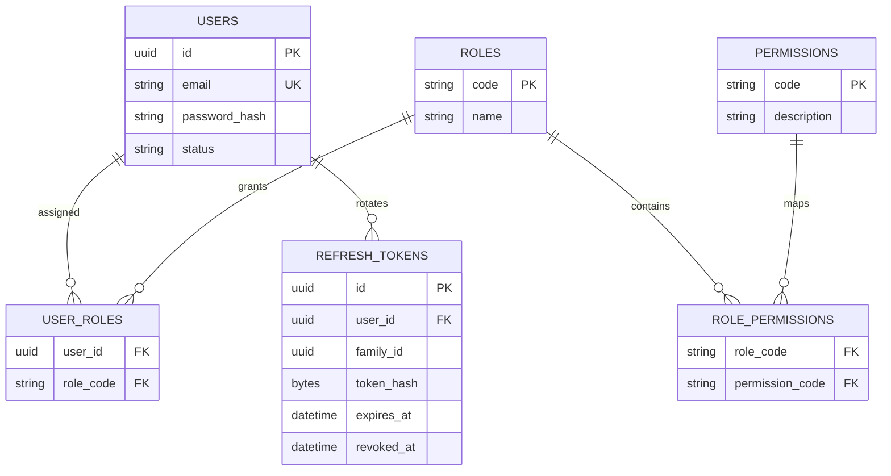
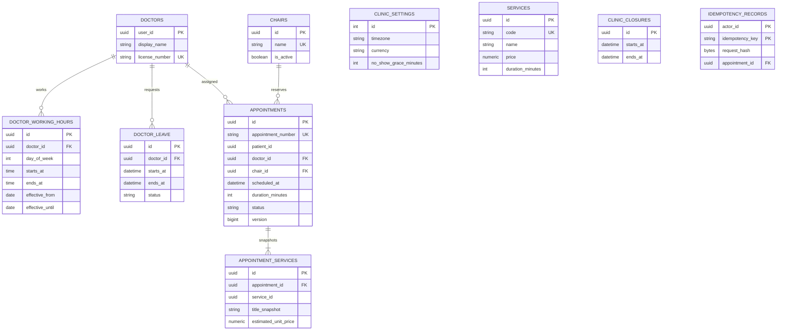
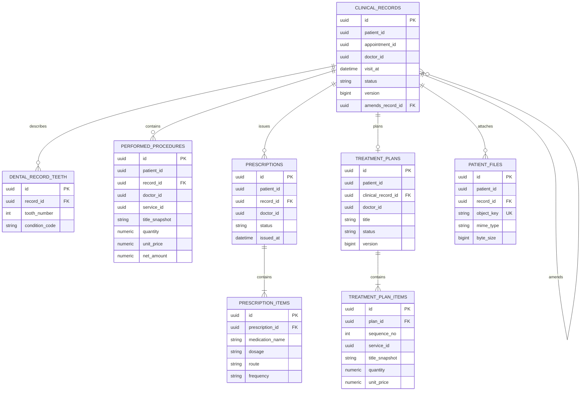

# ERD theo database sở hữu

Các sơ đồ là ba database tách biệt. UUID tham chiếu service khác được đánh dấu `id` và không có foreign key xuyên database. Chi tiết vật lý là các migration Flyway trong `backend/*/src/main/resources/db/migration`.

## Identity database



## Patient database

```mermaid
erDiagram
  PATIENTS ||--o{ PATIENT_CONSENTS : records
  PATIENTS ||--o| PATIENT_ACCOUNT_LINKS : linked_account
  PATIENTS ||--o{ PATIENT_ACCESS_GRANTS : permits
  PATIENTS { uuid id PK string patient_code UK string full_name string phone string allergies string medical_history }
  PATIENT_CONSENTS { uuid id PK uuid patient_id FK string consent_type string status datetime granted_at datetime revoked_at }
  PATIENT_ACCOUNT_LINKS { uuid patient_id PK_FK uuid user_id UK datetime linked_at }
  PATIENT_ACCESS_GRANTS { uuid patient_id PK_FK uuid doctor_id PK uuid appointment_id PK bigint aggregate_version datetime expires_at datetime revoked_at }
  PROCESSED_EVENTS { uuid event_id PK uuid aggregate_id bigint aggregate_version }
```

## Scheduling database



## Clinical database



## Notification database

```mermaid
erDiagram
  NOTIFICATIONS ||--o{ NOTIFICATION_JOBS : queues
  NOTIFICATION_JOBS ||--o{ NOTIFICATION_ATTEMPTS : records
  NOTIFICATIONS { uuid id PK uuid patient_id string channel string template_code string status uuid idempotency_key UK }
  NOTIFICATION_JOBS { uuid id PK uuid notification_id FK uuid event_id UK string recipient string status int attempts datetime next_attempt_at }
  NOTIFICATION_ATTEMPTS { uuid id PK uuid job_id FK int attempt_number string outcome datetime attempted_at }
  PROCESSED_EVENTS { uuid event_id PK uuid aggregate_id bigint aggregate_version }
```


